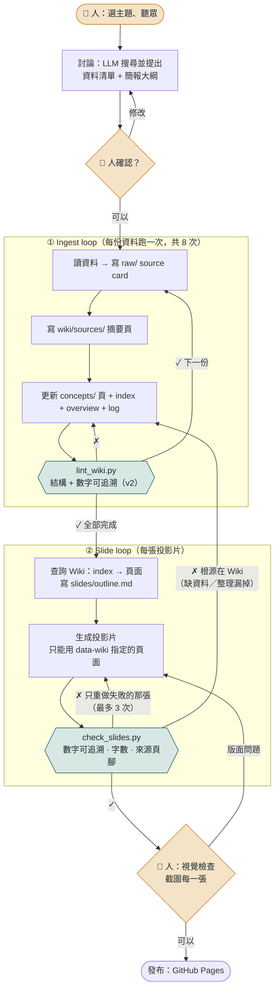

# Loop / Graph 設計：從資料到教學簡報

> 這份流程本身就是一個 Human-in-the-loop 系統：人負責選題、確認大綱、最後檢視；
> LLM 負責整理與生成；**程式化的檢查**負責擋住「沒有來源的內容」。

## 1. 流程圖（v2，實際執行後修改過的版本）

橘色 = 人類檢查點；綠色 = 程式化檢查。

## 2. 每個節點做什麼

| 節點 | 輸入 → 輸出 | 誰做 | 檢查 |
|---|---|---|---|
| 討論 | 主題 → 資料清單、大綱 | LLM 提案、人決定 | 👤 人確認 |
| 取得資料 | 網頁／論文 → `raw/s<N>-*.md` | LLM（WebSearch／WebFetch） | 書目資訊交叉查證（例如 S5 作者再搜一次確認） |
| 整理：來源頁 | raw → `wiki/sources/` | LLM | lint：數字要在 raw 找得到 |
| 整理：概念頁 | 多份來源 → `wiki/concepts/` | LLM | lint：含數字的行要有 [S#]，數字要在來源頁找得到 |
| 查詢 | Wiki → `slides/outline.md` | LLM | 每張投影片指定 `wiki:` 頁面 |
| 生成 | outline + Wiki 頁 → `slides/index.html` | LLM | check_slides：數字、字數、頁腳來源 |
| 視覺檢查 | 投影片 → 截圖 | 人（＋ 無頭瀏覽器截圖） | 👤 版面、可讀性 |

## 3. 哪些步驟會重複執行？

1. **Ingest loop**：每份資料跑一次（共 8 次）。每次都要更新多個 concept 頁、index、log，然後 lint。
2. **Lint 修正迴圈**：lint 沒過就回到「更新 concept 頁」，直到通過。
3. **Slide 生成迴圈**：check_slides 沒過，**只重新生成失敗的那幾張**，不整份重做（省時間，也避免改壞已經通過的投影片）。
4. **回到 Wiki 的長迴圈**：若失敗原因是 Wiki 缺內容或整理錯誤，不在投影片上硬改，而是回到 ingest 的整理節點修 Wiki，再重新檢查。

## 4. 哪些地方需要檢查或重新生成？

| 檢查點 | 抓什麼 | 失敗時 |
|---|---|---|
| 👤 討論確認 | 主題、聽眾、資料範圍是否正確 | 重新提案 |
| lint_wiki.py | 連結、孤兒頁、index 漏列、frontmatter、**數字沒來源或對不上**（v2） | 修 Wiki 頁 |
| 矛盾檢查（LLM） | 來源互相衝突、過時資訊 | 頁面加 ⚠️ 區塊並記 log |
| check_slides.py | 投影片上的數字不在 Wiki、字數過多、頁腳來源對不上 | 重新生成該張；3 次失敗回 Wiki |
| 👤 視覺檢查 | 版面、留白、遮擋 | 調整樣式後重新截圖 |

## 5. 為什麼這樣設計？

- **可追溯鏈**：簡報 → Wiki concept 頁 → Wiki 來源頁 → raw 卡片 → 原始網址。每一層都能被程式檢查，所以「Wiki 資料與簡報內容有明確對應」不是口頭說說，而是跑得出結果。
- **生成節點最容易出錯，所以它的輸入被限制住**：生成投影片時只能讀 `data-wiki` 指定的頁面，不能用模型自己的記憶。檢查器因此只要比對那幾頁就好。
- **數字是最好檢查、也最危險的內容**：數字錯了聽眾最容易被誤導，又最容易用程式比對，所以檢查集中在數字上。
- **局部重做**：一張失敗只重做那一張，避免整份重新生成時又產生新的錯誤。
- **人放在「便宜但關鍵」的位置**：選題、確認大綱、最後看版面。這些事人做很快，但 AI 做錯的代價很大。這正好就是簡報第 11 張「什麼時候該讓人檢查」的原則。
